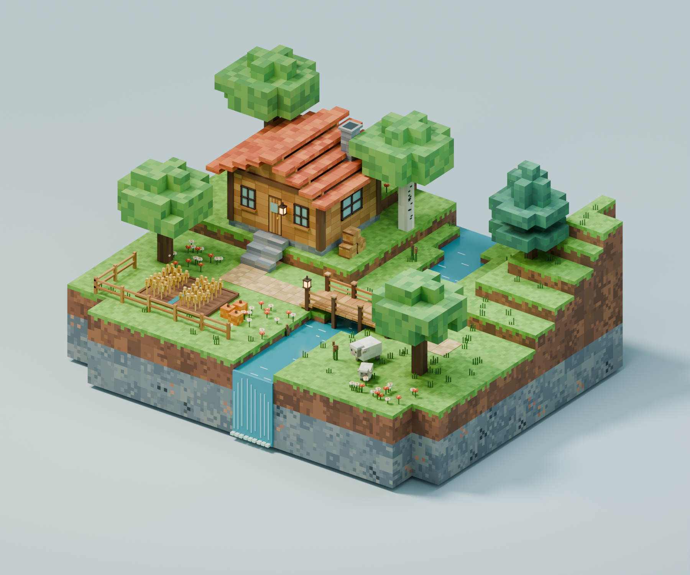

# My Minecraft World

[简体中文](README.zh-CN.md) | **English**

**[Play in your browser](https://xudafeng.github.io/my-minecraft-world/)**

A Minecraft-style forest world that started as a Blender voxel scene and grew into a first-person browser game. Cross the wooden bridge, explore the cabin, and mine and place blocks to build your own corner of the world.

Created with help from Codex. This repository includes the browser game source, a Blender scene generator, and an editable Blender project.

The game and documentation support English and Simplified Chinese, with English as the default. Use the **EN / 中文** switch in the top-right corner to change the interface language. Your browser remembers your choice, and switching languages preserves your world and player position. If the mouse is locked, press `Esc` to pause before switching.



_The image above is a Blender render. The browser game recreates the same theme in Three.js; its models and visuals differ from the Blender scene._

## Run locally

You need Node.js 22.13 or later, npm, and a browser with WebGL support. Installing dependencies requires an internet connection. Running locally requires no account or cloud service credentials.

```bash
npm install
npm start
```

Open <http://127.0.0.1:4173/my-minecraft-world/> in your browser and click **Enter world**. Keep the terminal running; press `Ctrl+C` to stop the server.

`npm start` needs no prior build and reloads game changes. To debug the Cloudflare Worker version, use `npm run dev`; to preview its build output, run `npm run build` followed by `npm run start:worker`.

## GitHub Pages

The game is published at <https://xudafeng.github.io/my-minecraft-world/>. The workflow in [`.github/workflows/pages.yml`](.github/workflows/pages.yml) tests and builds branches and pull requests. Only `main` deploys to the live site. In the repository's **Settings → Pages**, the publishing source is **GitHub Actions**.

To build and preview the same static version locally:

```bash
npm run build:pages
npm run preview:pages
```

Open the address printed in the terminal, including `/my-minecraft-world/`. This build reuses the game component and needs no backend server. Its assets are configured for the repository subpath in `vite.pages.config.ts`; update `base` there if you host it under another path.

## How to play

| Action                      | Controls                                                                            |
| --------------------------- | ----------------------------------------------------------------------------------- |
| Move                        | W / A / S / D or arrow keys                                                         |
| Look around                 | Move the mouse; if pointer lock is unavailable, hold the left mouse button and drag |
| Jump / Sprint               | Space / Shift                                                                       |
| Mine / Place                | Short left click / Right click                                                      |
| Select a block              | Number keys 1–6, scroll wheel, or click the hotbar                                  |
| Materials / Pick material   | E / Q (or middle click while the mouse is locked)                                   |
| Undo / Redo                 | Ctrl or Command + Z / Ctrl or Command + Shift + Z                                   |
| Return to the cabin / Pause | R / Esc                                                                             |

The world includes a cabin, a bridge, a river, trees, a wheat field, and two decorative sheep. It features gravity, collision detection, mining particles, and six customizable hotbar slots and a palette of all 13 editable materials. You play in first person with a visible arm. The touch interface provides buttons for movement, jumping, mining, and placing blocks.

This is a small adventure game with free building, treasure and creeper combat. **Your world is saved automatically in this browser**, including block changes, position, view, and hotbar. Edits save immediately; movement saves periodically and when paused. Wait for **Saved in this browser** before closing. Storage is device- and browser-specific, may be unavailable or cleared by the browser, and does not sync between devices. Use **Export world** in the pause menu to keep a JSON backup, then **Import world** to restore it on another device. Importing asks before replacing the current world.

Undo and redo cover the most recent 200 edits in the current session; reloading or importing starts a fresh undo history. A change that would place a solid block inside the player waits until the player moves away. Materials selected in the palette replace the currently selected hotbar slot. Bedrock stays protected.

If browser storage is blocked or a saved file is unreadable, the game stays playable and offers export instead of overwriting the existing save. If another tab saves first, this tab stops automatic writes and asks you to export before reloading. Multiplayer is not implemented. The sheep remain decorative, without farming mechanics.

## Blender project

Open [`blender/voxel-grove.blend`](blender/voxel-grove.blend) in Blender. The terrain, buildings, trees, and props are editable, with all materials included.

See the [Blender guide](blender/README.md) for the generator and rebuild instructions. The Blender project is for modeling and rendering; use the browser game above to play.

## Project structure

```text
app/world-game.tsx       Game interface and input controls
app/globals.css          Interface styles
github-pages/           Static browser entry for GitHub Pages
vite.pages.config.ts    Static build and project subpath
lib/voxel-world.ts       World generation, collisions, and raycasting
lib/voxel-game.ts        Three.js rendering, player movement, and block interactions
lib/i18n.ts              Translations and language preferences
lib/world-session.ts    Edit history and validated world snapshots
lib/world-storage.ts    Browser saves with concurrent-tab protection
lib/touch-input.ts      Independent movement and look pointers
tests/                  Physics, persistence, touch, and language tests
blender/                Editable scene and Python generator
docs/images/            Blender render preview
```

Built with TypeScript, React, Three.js, Vinext, and Vite. Development and preview use a local Cloudflare Worker emulator. `.openai/hosting.json` contains empty configuration and is not tied to a personal deployment.

## Validation

```bash
npm test
npx tsc --noEmit
npm run build
```

Tests cover physics, editable boundaries, undo/redo, snapshot validation, persistence transactions and conflicting tabs (using an IndexedDB test implementation), independent touch pointers, and language preferences. Basic movement and block interactions were checked in a local browser on the previous version. Browser interaction and physical-phone acceptance testing for this branch remain pending.

This is an independent project inspired by Minecraft's block-based style. It is not affiliated with Mojang or Microsoft.

## Treasure adventure

Find eight spinning golden relics across the pumpkin patch, bridge, forest, mountains and cabin rooftop. Walk into them to collect. The HUD shows your next destination, coordinates, progress and active play time. Build stairs to reach the roof.

- Three relics unlock faster movement and sprinting.
- Five relics unlock a second jump in midair.
- All eight record your personal best. Start another run from the pause menu; unlocked abilities carry into subsequent runs.

Pausing stops the timer. Adventure progress is included in autosaves and JSON exports; older saves remain compatible. This is a casual personal challenge, not a competitive or tamper-proof leaderboard.


## Creepers and survival

Five creepers patrol the wilds. They chase visible players and hop over low obstacles. At close range they flash during a 1.6-second fuse. Escape or break line of sight with a solid wall to defuse. Aim and left-click (touch: Punch / Mine) to knock them back; three punches defeat one.

Explosions destroy nearby editable blocks but preserve bedrock. Walls block immediate damage but may themselves be destroyed. At zero health you respawn at home with full health and keep your relics. The four-block radius at home is safe and gradually heals during daylight, but loses protection at night. R returns home without instant healing. Defeated enemies rest during daylight and return after 30 active seconds at night. Pausing freezes enemies and fuses. Health is saved; enemy positions reset on reload or import.

This is forgiving survival: death keeps your world and treasure progress. Undo/redo is disabled in adventure to prevent material duplication; creative retains the latest 200 edits.

## Day, night and crafting

Adventure is the default: 180-second days and 90-second nights, frozen while paused. Each dusk brings five creepers near camp. The sky and lighting change with time. Dawn awards 4 wood, 4 stone and 1 pumpkin. Mining gathers the block material; placing spends it. Start with 20 wood, 12 stone, 10 dirt and 2 pumpkins.

Open the pause menu or Craft / Camp for recipes: 1 log → 4 planks; 3 sand → 3 glass; 3 planks → 3 roof blocks; 6 planks + 8 stone → a stone sword (two-hit defeats); 1 pumpkin → a meal healing 35; 12 planks + 12 stone → a camp healing upgrade (three levels). Defeated creepers drop 2 stone.

Inventory, sword, camp upgrades, cycle time and nights survived are saved. Switch to creative in the pause menu for unlimited building and no enemies while preserving adventure inventory. Both modes share the edited world. Dawn rewards count active-time transitions even if you died during that night; treasure and resources are kept on death. This is forgiving solo play, not a competitive rule set.
